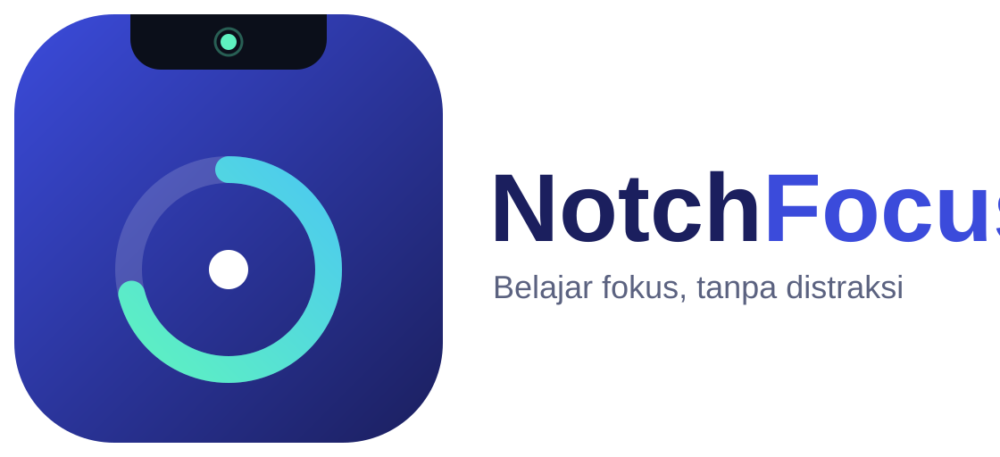

# Notch Fokus Pelajar



Halaman pengenalan (landing page) ada di [`docs/index.html`](docs/index.html) — folder `docs/` ini juga siap dipakai sebagai sumber GitHub Pages bila repo ini nanti dijadikan publik.

Notch ringan di atas layar Windows untuk pelajar: timer Pomodoro, to-do tugas, pengingat air dan istirahat, file shelf, status baterai, dan kontrol musik (placeholder — lihat bawah).

**Aplikasi ini TIDAK untuk Microsoft Store.** Distribusinya untuk pemakaian pribadi dan komunitas, lewat GitHub Releases atau file installer/zip yang dibagikan langsung.

**Bahasa UI: Bahasa Indonesia. Data: lokal saja — tanpa akun, tanpa sinkronisasi cloud, tanpa pelacakan, tanpa kirim data ke server mana pun.**

## Fitur v1

### Sudah jalan di prototipe ini

| Fitur | Status |
|---|---|
| Notch atas-tengah, transparan, tanpa frame, selalu di atas, tidak muncul di taskbar | ✅ Diimplementasikan (posisi atas-tengah diatur di `src-tauri/src/main.rs`; membesar saat hover lewat Tauri API, dengan fallback CSS di pratinjau web) |
| Timer Pomodoro 25 menit fokus / 5 menit istirahat, durasi bisa diubah, mulai/jeda/reset, ganti mode, bunyi lembut saat selesai, hitung sesi selesai | ✅ Jalan penuh |
| To-do tugas: tambah, centang selesai, hapus, tersimpan lokal (localStorage) | ✅ Jalan penuh |
| Pengingat air/istirahat: interval bisa diatur, pengingat di dalam aplikasi + bunyi lembut, tombol "Sudah minum" / "Sudah istirahat" untuk mengulang | ✅ Jalan penuh (dalam aplikasi) |
| File shelf: tambah file, daftar tersimpan lokal, klik untuk membuka | ✅ Jalan di aplikasi Tauri (lihat batasan di bawah) |
| Status baterai (`navigator.getBattery` bila tersedia) dan online/offline | ✅ Jalan (dengan fallback "tidak tersedia") |
| Jam di baris notch | ✅ Jalan |

### Placeholder yang jujur (belum jalan)

| Fitur | Status |
|---|---|
| Kontrol musik play/pause/next/previous untuk Spotify, YouTube, atau pemutar lain | ⚠️ **Placeholder saja.** Tombolnya ada di UI, tapi sengaja TIDAK mengontrol pemutar apa pun, dan tidak berpura-pura memutar lagu. Panelnya diberi label peringatan yang jelas. |
| Integrasi media sistem Windows (SMTC) | ⏭️ Langkah berikutnya. Perlu diimplementasikan di Rust memakai `GlobalSystemMediaTransportControlsSessionManager` Windows, lalu status lagu dikirim ke frontend lewat event Tauri. |
| Notifikasi sistem Windows untuk pengingat | ⏭️ Belum diimplementasikan. Pengingat saat ini hanya tampil di dalam aplikasi (banner + bunyi) — jadi pengingat hanya terlihat kalau notch sedang dibuka/dilihat. Plugin `tauri-plugin-notification` bisa ditambahkan di iterasi berikutnya. |
| Nama jaringan Wi-Fi dan kekuatan sinyal | ⏭️ Belum diimplementasikan. Yang ditampilkan hanya online/offline. |
| Lirik tersinkron | ❌ Sengaja tidak ada di v1. |

### Sengaja TIDAK ada di v1

Overlay FPS, stream chat/OBS, AI agent, sinkronisasi cloud, dan lirik tersinkron. Itu diputuskan di awal agar prototipe tetap kecil, ringan, dan cepat selesai.

## Batasan yang diketahui

1. **File shelf di pratinjau web:** browser sengaja tidak memberi path asli file, jadi yang tersimpan hanya nama file dan tombol "Buka" akan menjelaskan hal itu. Di aplikasi Tauri yang sudah di-build, tombol "Tambah file" memakai dialog pilih file bawaan Windows lewat command Rust `pick_file`, dan tombol "Buka" memakai command `open_path` (plugin-opener) — path tersimpan dan bisa dibuka dengan aplikasi default sistem.
2. **Build Rust belum terverifikasi dari VM Linux.** VM ini tidak punya Rust/cargo, dan build Windows memang tidak dijalankan dari sini. Build pertama yang benar adalah di PC Windows atau lewat GitHub Actions (lihat bawah). Kalau ada error kompilasi Rust di build pertama, perbaiki dari pesan error itu — jangan menganggap prototipe ini sudah ter-build.
3. **Ukuran jendela saat hover:** di Tauri, JavaScript mencoba `setSize` lewat API jendela; kalau API tidak tersedia, CSS hover tetap membesarkan tampilan di dalam jendela, tapi jendela itu sendiri tidak membesar. Di pratinjau web, fallback CSS-lah yang bekerja.
4. **Ikon:** ikon di `src-tauri/icons/` adalah placeholder sederhana yang dibuat untuk prototipe (bukan logo final). **Ikon biner tidak di-push ke repo** (alat push hanya menerima file teks); saat build di GitHub Actions atau PC, ikon di-generate dulu oleh `scripts/generate-icons.js` (Node tanpa dependensi) sebelum Tauri di-build, sehingga semua ikon yang dirujuk `tauri.conf.json` selalu tersedia.
5. **SmartScreen:** karena aplikasi tidak ditandatangani (code signing) dan tidak lewat Store, Windows akan menampilkan peringatan saat pertama dibuka. Itu normal untuk aplikasi dari developer independen. Lihat "Cara melewati SmartScreen" di bawah.

## Cara build dan tes di PC Windows

### Yang harus terinstal dulu

1. **Rust** — unduh dari https://rustup.rs, lalu restart terminal. Cek dengan `rustc --version`.
2. **Node.js LTS (20+)** — unduh dari https://nodejs.org. Cek dengan `node --version` dan `npm --version`.
3. **WebView2** — biasanya sudah ada di Windows 10/11 modern. Kalau belum, instal "Microsoft Edge WebView2 Runtime" dari situs Microsoft.
4. **Visual Studio Build Tools** — saat instal Rust di Windows, rustup biasanya meminta komponen ini (C++ build tools). Ikuti petunjuknya; tanpa ini, build Tauri akan gagal.

### Menjalankan dalam mode pengembangan

```powershell
cd notch-fokus-pelajar
npm install
npm run tauri dev
```

Notch akan muncul di atas-tengah layar. Arahkan kursor ke notch untuk membesarkan panel; gerakkan kursor menjauh untuk mengecilkannya lagi.

### Membuat installer

```powershell
npm run tauri build
```

Hasilnya ada di `src-tauri/target/release/bundle/` — biasanya berupa installer `.msi` dan setup `.exe` untuk Windows. Bagikan salah satu file itu (atau zip-nya) ke komunitas.

### Build otomatis lewat GitHub Actions

Push repo ini ke GitHub, lalu:

- Push ke branch `main` → workflow `Build Windows` jalan dan artefak installer tersimpan di halaman Actions.
- Buat tag, mis. `git tag v0.1.0 && git push origin v0.1.0` → workflow membuat **Draft Release** berisi installer. Periksa dulu isi draft-nya, lalu publish manual kalau sudah yakin.

File workflow: `.github/workflows/build-windows.yml`.

## Cara melewati SmartScreen (untuk pengguna yang kamu bagikan aplikasinya)

Karena aplikasi ini dibagikan langsung oleh developer yang dikenal — bukan dari Store dan belum ditandatangani — Windows akan menampilkan "Windows protected your PC" saat pertama dibuka. Langkahnya:

1. Jangan klik tombol yang menutup peringatan begitu saja; klik **More info**.
2. Klik **Run anyway**.
3. Lanjutkan instalasi seperti biasa.

Sampaikan ke komunitas bahwa langkah ini hanya perlu dilakukan sekali untuk file dari kamu, dan mereka sebaiknya **tidak** menjalankan file installer yang didapat dari sumber lain dengan nama yang sama.

## Struktur proyek

```text
notch-fokus-pelajar/
├── package.json                  # skrip npm + dependensi Tauri (API, dialog, opener)
├── README.md                     # dokumen ini
├── scripts/
│   └── generate-icons.js         # generate ikon placeholder (PNG + ICO) saat build; ikon biner tidak di-push
├── src/
│   ├── index.html                # antarmuka notch (Bahasa Indonesia)
│   ├── styles.css                # tampilan notch ciut/membesar
│   └── main.js                   # Pomodoro, to-do, pengingat, shelf, status, musik (placeholder)
├── src-tauri/
│   ├── tauri.conf.json           # nama, identifier, jendela transparan/atas/taskbar
│   ├── Cargo.toml                # dependensi Rust (tauri, dialog, opener)
│   ├── build.rs
│   ├── src/main.rs               # posisi atas-tengah + command pick_file / open_path
│   ├── capabilities/default.json # izin Tauri (window, dialog, opener)
│   └── icons/                    # ikon placeholder (png + ico)
└── .github/workflows/
    └── build-windows.yml         # build installer Windows di GitHub Actions
```

## Verifikasi yang sudah dilakukan (dari VM Linux, 24 Okt 2026)

- ✅ Semua file di atas ada dan terbaca.
- ✅ Sintaks JavaScript `src/main.js` lolos `node --check`.
- ✅ `package.json` valid JSON; `tauri.conf.json` konsisten: nama "Notch Fokus Pelajar", identifier `id.notchfokuspelajar.app`, jendela transparan/tanpa frame/selalu di atas/tanpa taskbar, `frontendDist` mengarah ke `../src`.
- ✅ Workflow GitHub Actions lolos cek sintaks YAML.
- ❌ **Belum terverifikasi:** build Rust (`cargo`) dan build Tauri di Windows — Rust tidak tersedia di VM ini, dan tidak ada file `.exe`/`.msi` yang dihasilkan atau dites di sini. Jangan menganggap prototipe ini sudah jadi installer sampai build Windows pertama berhasil.
